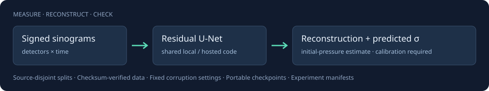

# PA Recon Lab

**Reproducible photoacoustic reconstruction, acquisition stress tests, and uncertainty evaluation.**

[](https://github.com/vinsymoyya/pa-recon-lab/actions/workflows/ci.yml)
[](LICENSE)
[](pyproject.toml)
[](MODEL_CARD.md)

[Quickstart](#quickstart) · [GPU notebook](https://www.kaggle.com/code/vinsymoyya/pa-recon-robust-synthetic-pilot) · [Results](#measured-results) · [Research roadmap](ROADMAP.md) · [Contribute](CONTRIBUTING.md)



PA Recon Lab provides a compact, inspectable PyTorch baseline for mapping detector/time sinograms to initial-pressure images. It keeps data provenance, training splits, checkpoints, corruption settings, and evaluation outputs together so other researchers can reproduce and challenge a result.

The current release is an early research toolkit. Its completed GPU pilot improves error over zero output and shows a clean-versus-corrupted input trade-off between training arms. Real measurements, analytical reconstruction baselines, and uncertainty calibration remain open work. Diagnostic and universal virus/DNA detection claims are unsupported by this project.

## What you can do today

- Download a public synthetic subset with checksum verification.
- Train a residual U-Net with optional paired source mixing, noise, detector dropout, and gain perturbations.
- Compare unaugmented and augmented training with one declared configuration.
- Evaluate clean and corrupted measurements with per-sample/group metrics and bootstrap intervals.
- Predict from an input-only HDF5 file using the same checkpoint format locally and on Kaggle.
- Audit the split, dataset hash, configuration, source hash, and environment in each experiment manifest.

## Quickstart

```bash
git clone https://github.com/vinsymoyya/pa-recon-lab.git
cd pa-recon-lab
python -m venv .venv
# Linux/macOS: source .venv/bin/activate
# Windows PowerShell: .\.venv\Scripts\Activate.ps1
python -m pip install -e .
pa-recon download-data
```

The download is the 168 MB, 100-sample development subset from [Alagappan et al., Zenodo](https://doi.org/10.5281/zenodo.21785486), licensed CC BY 4.0. Code is MIT; data retains its own license. Install an appropriate CUDA build of PyTorch before training on your GPU.

Run the declared GPU comparison:

```bash
pa-recon run --config configs/pilot.json --output runs/pilot --require-cuda
```

The pilot trains two arms for 50 epochs each, selects each checkpoint by validation loss, and writes clean/stress metrics to a new output directory. It refuses to overwrite an existing run. It is a software and experiment pilot on 80 training, 10 validation, and 10 test sources; the subset cannot support final performance claims.

**Use a hosted GPU:** open the [Kaggle notebook](kaggle_kernel/train.ipynb), or follow the [CLI launch guide](kaggle_kernel/README.md). The notebook embeds the package source and calls the same CLI. GPU and Internet must be enabled. Version 1 completed on a Tesla T4; the public notebook now runs 45 reliability checks before training.

**Use a CPU or your own data:** see the [manual training and inference guide](docs/USAGE.md). HDF5 inputs are signed `sinogram` arrays, `(N, detectors, time)`; targets are `IP`, `(N, depth, lateral)`. The two spatial dimensions need not match.

## Run inference

**No local installation:** [fork the CPU inference notebook](https://www.kaggle.com/code/vinsymoyya/pa-recon-open-model-inference). It attaches the open data and model, predicts one development test source, and plots the reference, reconstruction, error and uncalibrated sigma. GPU and Internet are not required.

After training, the checkpoint works directly with:

```bash
pa-recon predict --file data/example_subset_100_samples.h5 \
  --checkpoint runs/pilot/augmented/model.pt --sample-index 3 \
  --output runs/prediction.npz
```

The NPZ contains `reconstruction`, `predicted_sigma`, and `sinogram` in the dataset's relative units. Inference does not require a target dataset. Both pretrained arms are available from [Kaggle Models](https://www.kaggle.com/models/vinsymoyya/pa-recon-lab). Predicted sigma needs calibration before use as a reliable interval.

## Measured results

The completed Tesla T4 pilot trained two width-16 arms for 50 epochs on 80/10/10 synthetic source partitions. Checkpoints were selected on validation loss. Metrics below use the same ten development test sources and corruption realization per condition.

| Condition | Unaug. MAE ↓ | Aug. MAE ↓ | Unaug. RMSE ↓ | Aug. RMSE ↓ |
|---|---:|---:|---:|---:|
| Clean | 0.053400 | 0.054986 | 0.094284 | 0.094469 |
| Mild | 0.056003 | 0.054657 | 0.096463 | 0.093939 |
| Moderate | 0.059904 | 0.057268 | 0.100425 | 0.096362 |
| Severe | 0.065107 | 0.062507 | 0.107071 | 0.102824 |

Augmentation lowers severe pooled RMSE by **3.97%** and increases clean MAE by **2.97%**. Zero-output MAE/RMSE are 0.065148/0.168156. It is a sanity comparator; conventional acoustic reconstruction remains a required baseline. A paired source-group bootstrap gives severe macro-RMSE delta -0.004451, exploratory 95% interval [-0.006430,-0.002380]. Macro and pooled RMSE are different endpoints. Sigma is uncalibrated.

These are inspected development results from one training seed and one simulation setup. They do not establish device or clinical generalization. [Raw metrics and hashes](results/kaggle-v1/README.md) · [Pilot report](paper/PILOT_REPORT.md) · [Model card](MODEL_CARD.md). The older local demo remains separately archived in `results/development/`.

**Observed failure:** the public inference example (source 6062, first development test source) loses much of the fine/deep vessel pattern. Aggregate RMSE gains do not demonstrate anatomical recovery. [View reconstruction, reference and error](docs/assets/pilot_reconstruction.png).

## Open data, models and checks

- [Data on Kaggle](https://www.kaggle.com/datasets/vinsymoyya/photoacoustic-skin-phantoms-100-source-mirror): unmodified 100-source subset, original authors credited, CC BY 4.0.
- [Models on Kaggle](https://www.kaggle.com/models/vinsymoyya/pa-recon-lab): MIT weights for both arms, model card, checksums, metrics, scales and splits.
- [Public GPU training](https://www.kaggle.com/code/vinsymoyya/pa-recon-robust-synthetic-pilot): fork and rerun the same package and configuration.
- [45 named reliability checks](docs/RELIABILITY.md): leakage, normalization, numerical behavior, inference, provenance, failure recovery and paired statistics. Passing software checks does not establish scientific or clinical validity.

```bash
python scripts/check_reliability.py --expected 45
# With the optional Kaggle CLI installed and authenticated:
kaggle models instances versions download vinsymoyya/pa-recon-lab/pyTorch/augmented/1 -p checkpoints/augmented --untar
```

To reproduce the release staging, see [publication instructions](docs/PUBLICATION.md). Cite the original dataset alongside this toolkit. Reproducible comparisons, documented negative results, and meaningful forks help the project grow.

## Research direction

Our target is reconstruction that remains useful as acquisition conditions change: explicitly model the measurement operator, preserve data consistency, quantify failure, and evaluate outside the training setup. The [roadmap](ROADMAP.md) sets evidence gates for physics-conditioned reconstruction, controlled simulation diversity, calibrated uncertainty, and independent measured-data evaluation. These are research hypotheses; novelty and gains must be established experimentally against prior methods.

## Contribute

The most useful first contributions are an analytical baseline, an independent phantom benchmark, uncertainty calibration, and reproducible failure cases. See [CONTRIBUTING.md](CONTRIBUTING.md), [open issues](https://github.com/vinsymoyya/pa-recon-lab/issues), and the [research blueprint](PAI_RESEARCH_BLUEPRINT.md). Negative results with a complete manifest are welcome.

If the toolkit saves you experiment setup time, a star helps others find it. Fork it to add a reproducible method or benchmark; improvements are judged by evidence.

## Cite and reuse

Use [CITATION.cff](CITATION.cff) to cite the software, and cite each dataset and method you use separately. This repository has no associated peer-reviewed paper yet. [License](LICENSE) · [Security](SECURITY.md) · [Community standards](CODE_OF_CONDUCT.md).
