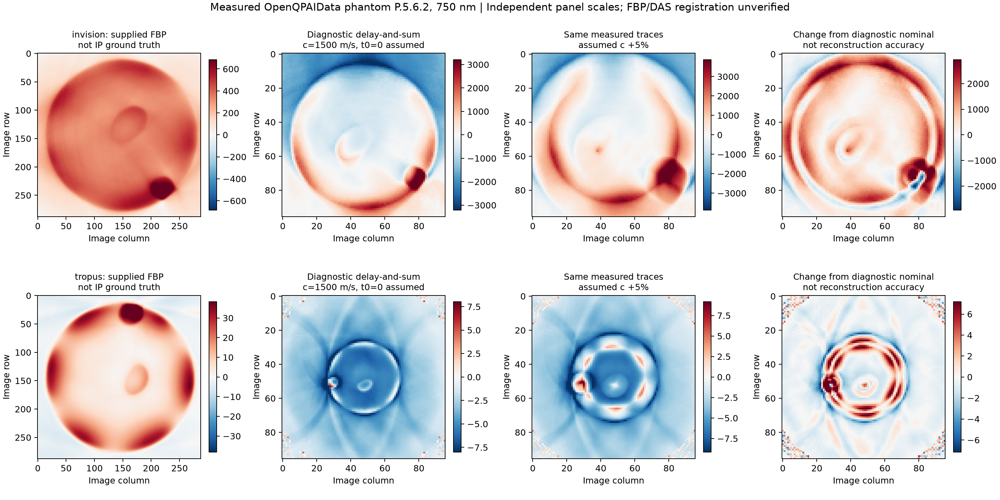
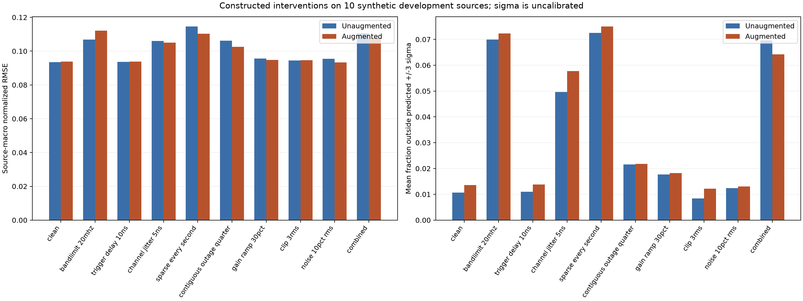

# Acquisition variation and failure investigation — 5 November 2026

## What was actually acquired and analysed

We obtained **measured** IPASC-format records for phantom `P.5.6.2` at 750 nm from two physical systems in [Gröhl et al., OpenQPAIData, Zenodo v1](https://doi.org/10.5281/zenodo.14044853): MSOT InVision and TROPUS. The phantom ID was fixed from the authors' [loading tutorial](https://github.com/BohndiekLab/OpenQPAIData/blob/main/examples/read_PAI_data.py), before reconstruction scoring. One record per device was analysed; these are not independent patient samples. Equal phantom IDs do not establish image registration or identical acquisition conditions.

The raw records, supplied filtered-backprojection (FBP) reconstructions, and material labels retain **CC BY 4.0**. Code is MIT. Reference reconstructions and material segmentations are **not ground truth initial pressure**. No real-scanner neural accuracy is reported.

The efficient fetcher retrieves six selected members using exact HTTP ranges from the deposited ZIP archives. Each member is checked against the ZIP directory CRC32 and recorded with SHA256. Whole-archive published MD5 values are retained as references but **were not verified**, because complete 525 MB archives were not downloaded. The selection manifest records this distinction.

## Measured acquisition differences and observed flags

| Property | InVision example | TROPUS example | Existing synthetic model |
|---|---:|---:|---:|
| Detectors | 256 | 512 | 256 |
| Time samples | 2,030 | 2,094 | 1,207 |
| Sampling rate | 40 MHz recorded | 40 MHz recorded | 500 MHz inferred |
| Geometry | Curved planar array | Curved planar array | Top-boundary line |
| Metadata x-z FOV width | 32 mm | 64 mm | 2.56 mm simulation grid extent |
| Mean raw DC | +36,025.69 | -2,009.80 | Signed synthetic pressure, different units |
| RMS after per-channel mean removal | 3,941.82 | 62.97 | No calibrated amplitude mapping |

The inferred synthetic step is `CFL * dx / c = 0.3 * 10 μm / 1500 m/s = 2 ns`, from the released simulator and [k-Wave's documented time-step rule](https://www.k-wave.org/documentation/kWaveGrid.php). It is not a measured per-sample time-axis field. Resizing measured arrays cannot reconcile geometry, timing, field of view, detector response or units.

**Observed flags:** 67 InVision samples equal 65,535. This is a possible ADC-rail flag, not confirmed saturation without ADC specifications. TROPUS contains 1,024 zeros and a substantial negative baseline; zero values alone do not establish failed channels. No exact-zero detector was found in either example. Pulse-energy units, trigger/time origin, sound-speed calibration, ADC calibration and impulse-response measurements are absent or unresolved in these records. No physical claim is made from raw amplitude differences across devices. Raw spectral summaries include finite-window effects and do not estimate calibrated detector bandwidth.

The audit marks transfer of the existing neural checkpoint **blocked**. It records the reasons rather than fitting these two records or treating an absorption/FBP map as an IP target.

## Sensitivity on measured traces

An explicit diagnostic delay-and-sum beamformer uses the recorded detector positions and sampling, with **assumed** constant sound speed 1500 m/s and time origin zero. These assumptions are required CLI arguments. They are not measured calibration. The beamformer uses point receivers and linear time interpolation; it omits directivity, response inversion, solid-angle weighting and full quantitative inverse physics.

We change reconstruction assumptions while keeping the recorded traces fixed, and separately construct channel/timing/filter interventions on those traces. These are **post-acquisition/operator sensitivity experiments**, not new scanner acquisitions or resimulations of different tissue media.

| Scenario | InVision relative map change | TROPUS relative map change |
|---|---:|---:|
| Assumed sound speed −5% | 1.103 | 0.588 |
| Assumed sound speed +5% | 0.844 | 0.499 |
| Assumed detector positions perturbed by 0.1 mm SD | 0.035 | 0.114 |
| Recorded traces delayed by two samples (50 ns) | 0.053 | 0.136 |
| Half the detectors zero-filled | 0.508 | 0.505 |
| Central quarter of detectors zero-filled | 0.661 | 0.396 |

Change is `||modified DAS − nominal DAS||₂ / ||nominal DAS||₂`; it is **sensitivity, not accuracy**. The missing-channel experiment retains normalization by the original detector count, so changes include amplitude loss and image artifacts. Position jitter is an assumed-coordinate error, not a new physical sensor acquisition. Parameters are declared engineering scenarios rather than empirical failure distributions.



Panels use independent scales. The supplied FBP image's registration/FOV relative to the diagnostic grid is unverified. Their displayed similarity must not be used as a quantitative accuracy comparison. Source imagery: Gröhl et al., CC BY 4.0.

## Neural failure study on the existing synthetic development set

The two unchanged v0.2.0 checkpoints were evaluated on the same ten inspected development sources under ten declared conditions. There were 560 predictions, but **only ten unique source units**. Three corruption seeds were used; deterministic cases were also repeated and are averaged within each source, not counted as independent observations. Checkpoint, dataset and split hashes are retained. These results are separate from measured-data sensitivity.

| Condition | Unaugmented macro RMSE | Augmented macro RMSE |
|---|---:|---:|
| Clean | 0.09354 | 0.09386 |
| Extra 20 MHz Gaussian low-pass | 0.10688 | 0.11214 |
| Trigger delay 10 ns | 0.09357 | 0.09388 |
| Per-channel timing jitter 5 ns SD | 0.10595 | 0.10508 |
| Every second detector retained | 0.11459 | 0.11034 |
| Central quarter detector outage | 0.10626 | 0.10254 |
| Gain ramp ±30% | 0.09559 | 0.09482 |
| Symmetric clipping at 3 input RMS | 0.09448 | 0.09465 |
| Noise SD 10% input RMS | 0.09544 | 0.09340 |
| Combined bandwidth/delay/outage/noise | 0.11070 | 0.10780 |

Macro RMSE is the mean source RMSE, not pooled pixel RMSE. The low-pass intervention adds a zero-phase Gaussian magnitude filter with −3 dB at 20 MHz; it is not a measured instrument response. Timing uses zero extension, with no circular wrap. Zero-filled channels retain their original coordinate indices and the availability mask is recorded. Noise is added after dropout; clipping is relative to input RMS, not an asserted ADC voltage.

**Failures exposed:**

- The old augmentation is not uniformly robust. With extra bandwidth loss its paired macro-RMSE disadvantage is +0.00526, exploratory 95% source-bootstrap interval [+0.00207,+0.00869]. There is no correction for multiple comparisons or training-seed uncertainty.
- Under half-detector sampling, the augmented model has about **7.5% of pixels outside its uncalibrated ±3σ**, versus 1.36% clean. The predicted sigma does not provide a dependable failure guarantee.
- Even clean inputs have hidden regional weaknesses. In depth rows 128–191, the mean source RMSE/target-RMS ratio is **1.14** for the augmented model and **1.08** unaugmented; zero output has ratio one. This fixed depth band is not a vessel segmentation metric.
- Source ID 45455 has the highest mean RMSE in every examined condition for both models. This is a post hoc failure example, not a separately held-out discovery set.



The analytic center-point arrival probe focuses at the expected image center and compensates a known two-sample delay with relative map error below `1e-6`. This checks time sign, interpolation and coordinate units, not full acoustic inverse validity. [Raw evidence and probe](../results/acquisition-20261105/).

## Reproduce

[Run the acquisition investigation on Kaggle](https://www.kaggle.com/code/vinsymoyya/pa-recon-acquisition-failure-investigation). It attaches both published models and the synthetic subset, retrieves the fixed measured examples, and executes the same package functions. GPU and Internet are required. Notebook source is generated with `scripts/build_acquisition_notebook.py`.

```bash
python -m pip install -e ".[figures]"
python scripts/fetch_measured_examples.py
python -m pa_recon.measured --output runs/measured-audit \
  --assumed-sound-speed-m-s 1500 --assumed-time-origin-s 0
python -m pa_recon.acquisition_study \
  --file data/example_subset_100_samples.h5 --splits results/kaggle-v1/splits.csv \
  --checkpoint checkpoints/unaugmented/model.pt --checkpoint checkpoints/augmented/model.pt \
  --output runs/acquisition-failures
python scripts/report_acquisition_failures.py \
  --synthetic-run runs/acquisition-failures --measured-run runs/measured-audit \
  --output results/new-acquisition-study
```

Use the published v0.2.0 weights and a new output directory for each run. Configuration: `configs/acquisition_failure_study.json`. The source audit can also ingest additional explicitly selected singleton-wavelength/frame IPASC records; it rejects ambiguous axes instead of guessing. The declared physics scenarios are development investigations and must not be tuned against a final holdout.

## Next evidence gate

Obtain calibrated trigger timing, sound speed/temperature, ADC units, sensor impulse responses and verified reconstruction coordinates for each device. Register physical phantom labels independently. Reconstruct with an independently validated geometry-aware inverse and task-based endpoints, then compare a model trained across appropriately varied operators. Freeze phantom/device partitions before tuning. These two example records establish access and observable acquisition differences, not statistical cross-device generalization.
